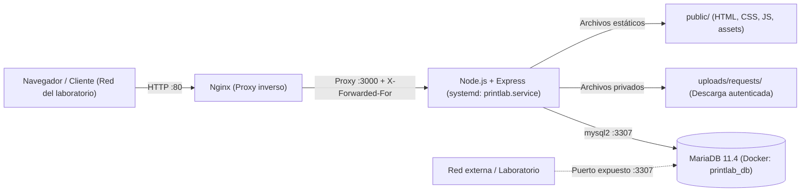

# PrintLab 3D

Tienda web y gestor de impresiones 3D con **vulnerabilidades controladas**, desarrollado y desplegado en un servidor Linux (Ubuntu Server en máquina virtual) para entorno académico de laboratorio (desarrollo web, administración de servidores y seguridad ofensiva/defensiva).

---

## Tabla de contenidos

1. [Descripción del proyecto y roles del sistema](#1-descripción-del-proyecto-y-roles-del-sistema)
2. [Arquitectura completa](#2-arquitectura-completa)
3. [Guía de instalación y despliegue paso a paso](#3-guía-de-instalación-y-despliegue-paso-a-paso)
4. [Usuarios y credenciales de prueba](#4-usuarios-y-credenciales-de-prueba)
5. [Vulnerabilidades implementadas y controles de seguridad](#5-vulnerabilidades-implementadas-y-controles-de-seguridad)
6. [Flujo de trabajo en GitHub (GitFlow)](#6-flujo-de-trabajo-en-github-gitflow)

---

## 1. Descripción del proyecto y roles del sistema

**PrintLab 3D** es una aplicación web para un taller de impresión 3D que permite:
- Explorar un catálogo de piezas impresas (carrusel destacado en inicio y catálogo completo con buscador, filtro por categoría y material `PLA`, `PETG`, `ABS`).
- Realizar compras con carrito persistente, elección de método de pago (`Transferencia bancaria` o `Efectivo contra entrega`), actualización transaccional de stock y generación de **facturas imprimibles** (`/factura.html?id=...`).
- Enviar **solicitudes de impresión personalizada** con archivo de referencia descargable (`.stl`, `.obj`, `.3mf`, `.png`, `.jpg`, `.webp` hasta 10 MB), cotización con precio numérico, confirmación del cliente (`En cola de pedidos`), cancelación y registro completo de historial por pedido.
- Administrar catálogo, categorías, solicitudes, facturas y cuentas de usuario desde paneles separados por pestañas.

### Roles y vistas del sistema

| Vista / Ruta | Rol requerido | Funcionalidades principales |
|---|---|---|
| `/` (`index.html`) | Público / Todos | Página de inicio, carrusel de catálogo destacado, información de materiales y formulario de impresión personalizada (exige iniciar sesión al interactuar). Para compradores incluye **Mis solicitudes** y **Mis facturas**. |
| `/catalogo.html` | Público / Todos | Catálogo completo con buscador, filtro por categoría y material. Para `vendedor`/`admin` el botón de compra cambia a **Editar** y redirige al panel. |
| `/acceso.html` | Público | Inicio de sesión y registro de nuevos compradores (con indicador en vivo de requisitos de contraseña y botón para ver/ocultar contraseña). |
| `/factura.html?id=X` | Autenticado | Comprobante imprimible/PDF de una factura (solo accesible por el comprador dueño o por `admin`). |
| `/vendedor.html` | `vendedor` o `admin` | Panel en pestañas: **Catálogo** (CRUD de piezas con foto drag-and-drop y creación de categorías) y **Solicitudes** (filtros por estado, descarga segura de archivo, cotización numérica, comentario opcional e historial). |
| `/admin.html` | `admin` | Panel completo en pestañas: **Catálogo**, **Solicitudes** (incluye rechazo), **Facturas** (todas las ventas con enlace imprimible) y **Cuentas** (CRUD completo de usuarios, roles, activación/desactivación con protección de al menos un administrador activo). |

> Las vistas `/admin.html` y `/vendedor.html` están protegidas tanto en el **servidor** (redirección HTTP `302` a `/acceso.html` si no cumple el rol) como en el **cliente**, y los endpoints administrativos exigen sesión y rol mediante middleware (`requireAuth`, `requireRole`).

---

## 2. Arquitectura completa

### Stack tecnológico

El proyecto utiliza exclusivamente tecnologías aprobadas y sin abstracciones prohibidas (sin ORM, sin Helmet, sin csurf, sin Passport, sin frameworks frontend que saneen automáticamente):

| Capa | Tecnología |
|---|---|
| **Sistema operativo** | Ubuntu Server 22.04 / 24.04 LTS en máquina virtual (VMware Workstation) |
| **Servidor web / Proxy inverso** | Nginx (puerto `80` → `127.0.0.1:3000`, `server_tokens off`, `client_max_body_size 15M`) |
| **Backend** | Node.js 22 LTS + Express 5 + `express-session` + `bcrypt` + `dotenv` |
| **Acceso a base de datos** | Driver directo `mysql2` (sin ORM) |
| **Base de datos** | MariaDB 11.4 ejecutada en contenedor Docker (`printlab_db`) |
| **Frontend** | HTML5, CSS3 y JavaScript Vanilla (servido desde `public/`) |
| **Gestor de servicio** | `systemd` (`printlab.service`) |

### Diagrama de arquitectura



### Esquema de base de datos (`printlab3d`)

| Tabla | Propósito |
|---|---|
| `users` | Cuentas del sistema (`username`, `password_hash` con bcrypt, `email`, `role`, `active`). |
| `categories` | Categorías del catálogo (`Figuras`, `Llaveros`, `Repuestos`, `Prototipos`, `Escritorio`, `Hogar` + las creadas desde el panel). |
| `products` | Piezas del catálogo (`seller_id`, `category_id`, `name`, `description`, `price`, `stock`, `material`, `print_time`, `image_path`). |
| `invoices` | Encabezados de factura (`buyer_id`, `total`, `created_at`). |
| `invoice_items` | Líneas de detalle de cada factura (`invoice_id`, `product_id`, `quantity`, `unit_price`). |
| `custom_requests` | Solicitudes de impresión personalizada (`user_id`, `piece_name`, `material`, `description`, `reference_file`, `stored_file`, `status`, `quote_price`, `seller_note`, `notified_at`). |
| `custom_request_history` | Historial de cambios de estado, cotizaciones y comentarios por solicitud. |
| `login_failures` | Registro de auditoría de intentos de inicio de sesión (`username`, `ip_address`, `forwarded_for`, `user_agent`, `reason`, `created_at`). |

**Roles en MariaDB (`sql/schema.sql`):**
- `admin_db` (`rol_admin`): administración sobre `printlab3d.*`.
- `auditor_db` (`rol_auditor`): solo lectura (`SELECT`) sobre `printlab3d.*`.
- `printlab_user` (`rol_app`): usuario utilizado por el backend Node.js.
- `root`: deshabilitado (`DROP USER 'root'@'%'` y `ALTER USER 'root'@'localhost' ACCOUNT LOCK`).

### Estructura de carpetas

```text
PrintLab_3D/
├── public/                        # Frontend servido como raíz web
│   ├── index.html                 # Inicio, carrusel destacado, materiales y solicitudes
│   ├── catalogo.html              # Catálogo completo con buscador y filtros
│   ├── acceso.html                # Login y registro
│   ├── vendedor.html              # Panel de vendedor (pestañas Catálogo y Solicitudes)
│   ├── admin.html                 # Panel de administrador (4 pestañas)
│   ├── factura.html               # Comprobante imprimible
│   ├── styles.css                 # Estilos generales
│   ├── factura.css                # Estilos de factura e impresión (@page margin: 0)
│   ├── app.js                     # Lógica de tienda, carrito, pagos y solicitudes del cliente
│   ├── panel.js                   # Lógica de paneles vendedor/admin
│   ├── acceso.js                  # Login, registro y validación en vivo de contraseña
│   ├── factura.js                 # Renderizado y carga de facturas
│   ├── store.js                   # Estado de sesión cliente y navegación
│   ├── menu.js                    # Menú responsive
│   └── assets/productos/          # Imágenes base del catálogo
├── src/                           # Backend Node.js / Express
│   ├── server.js                  # Arranque del servidor e inicialización/migración de BD
│   ├── app.js                     # Middlewares de seguridad, sesiones, rutas y estáticos
│   ├── config/db.js               # Pool de conexión mysql2 a MariaDB
│   ├── middlewares/
│   │   └── role.middleware.js     # requireAuth y requireRole
│   ├── controllers/
│   │   ├── auth.controller.js     # Login (vulnerable a fuerza bruta), registro, CRUD usuarios y auditoría
│   │   ├── catalog.controller.js  # CRUD de productos y categorías
│   │   ├── invoices.controller.js # Checkout transaccional con bloqueo de stock y listado
│   │   └── requests.controller.js # Solicitudes, historial, aceptar/cancelar y descarga segura
│   └── routes/
│       ├── auth.routes.js
│       ├── catalog.routes.js
│       ├── invoices.routes.js
│       └── requests.routes.js
├── sql/
│   └── schema.sql                 # Tablas, categorías iniciales, roles RBAC y bloqueo de root
├── scripts/
│   ├── seed-data.js               # Datos realistas de prueba (npm run seed)
│   ├── test-auth.js               # Pruebas de autenticación
│   └── test-catalog.js            # Pruebas de catálogo
├── uploads/                       # Archivos subidos en solicitudes (fuera de public/, bloqueado por HTTP)
├── docker-compose.yml             # Contenedor MariaDB 11.4 con puerto 3307 expuesto
├── .env.example                   # Plantilla de variables de entorno
└── package.json
```

---

## 3. Guía de instalación y despliegue paso a paso

> Tiempo estimado de despliegue limpio en la VM: **10 a 15 minutos**.

### Paso 1 — Crear la máquina virtual (VMware Workstation)

1. Crear una VM con **Ubuntu Server 22.04 o 24.04 LTS** (2 vCPU, 2–4 GB RAM, 20 GB disco).
2. En el instalador:
   - Crear usuario administrador (ej. `reneesalmeron`) y nombre de host `printlab3d`.
   - Marcar **`[X] Instalar servidor OpenSSH`**.
3. Configurar **dos adaptadores de red** (con la VM apagada en *Settings*):
   - **Network Adapter 1:** `NAT` (`ens33`, salida a internet y SSH local estable).
   - **Network Adapter 2:** `Bridged` (`ens38`, conectado a la red física del laboratorio). En *Edit → Virtual Network Editor → VMnet0*, enlazar `Bridged to:` a la tarjeta Wi-Fi/Ethernet activa.
4. Encender la VM y configurar `ens38` con prioridad de ruta secundaria (para que internet siempre salga por `ens33` incluso en redes con portal cautivo):

```bash
sudo tee /etc/netplan/60-ens38.yaml > /dev/null <<'EOF'
network:
  version: 2
  ethernets:
    ens38:
      dhcp4: true
      optional: true
      dhcp4-overrides:
        route-metric: 200
EOF
sudo chmod 600 /etc/netplan/60-ens38.yaml
sudo netplan apply
ip -br -4 a
```

### Paso 2 — Configurar acceso SSH con llave pública (desde tu PC Windows)

```powershell
# Si aún no tienes llave SSH:
ssh-keygen -t ed25519 -C "tu_correo@ejemplo.com"

# Copiar llave pública a la VM (reemplaza IP_VM por la IP de ens33):
Get-Content "$env:USERPROFILE\.ssh\id_ed25519.pub" | ssh reneesalmeron@IP_VM "mkdir -p ~/.ssh && chmod 700 ~/.ssh && cat >> ~/.ssh/authorized_keys && chmod 600 ~/.ssh/authorized_keys"

# Verificar entrada sin contraseña:
ssh reneesalmeron@IP_VM
```

### Paso 3 — Instalar dependencias del sistema y Node.js 22 (en la VM)

```bash
sudo apt update && sudo apt upgrade -y
sudo apt install -y git curl nginx ufw docker.io docker-compose-v2 unattended-upgrades

curl -fsSL https://deb.nodesource.com/setup_22.x | sudo -E bash -
sudo apt install -y nodejs

sudo usermod -aG docker $USER
```

> Cierra sesión (`exit`) y vuelve a entrar por SSH para aplicar el grupo `docker`.

### Paso 4 — Clonar el repositorio en `/var/www/PrintLab_3D` e instalar paquetes

```bash
sudo mkdir -p /var/www/PrintLab_3D
sudo chown -R $USER:$USER /var/www/PrintLab_3D

git clone https://github.com/reneesalmeron7/PrintLab_3D.git /var/www/PrintLab_3D
cd /var/www/PrintLab_3D
npm install
```

*(Si deseas desplegar la rama de integración en pruebas antes del merge a `main`, corre `git checkout develop`).*

### Paso 5 — Crear archivo `.env`

```bash
cat <<'EOF' > /var/www/PrintLab_3D/.env
DB_HOST=127.0.0.1
DB_PORT=3307
DB_USER=printlab_user
DB_PASSWORD=printlab_pass
DB_NAME=printlab3d

MARIADB_ROOT_PASSWORD=rootpassword
MARIADB_PASSWORD=printlab_pass

PORT=3000
SESSION_SECRET=clave_secreta_larga_aleatoria_printlab_2026
EOF
chmod 600 /var/www/PrintLab_3D/.env
```

### Paso 6 — Levantar MariaDB en Docker y poblar datos

```bash
cd /var/www/PrintLab_3D
docker compose up -d
sleep 10
docker ps
npm run seed
```

### Paso 7 — Crear y activar el servicio `systemd` (`printlab.service`)

```bash
printf '[Unit]\nDescription=PrintLab 3D\nAfter=network.target docker.service\n\n[Service]\nType=simple\nUser=%s\nWorkingDirectory=/var/www/PrintLab_3D\nExecStart=%s /var/www/PrintLab_3D/src/server.js\nRestart=always\nRestartSec=3\nEnvironment=NODE_ENV=production\n\n[Install]\nWantedBy=multi-user.target\n' "$USER" "$(which node)" | sudo tee /etc/systemd/system/printlab.service > /dev/null
sudo systemctl daemon-reload
sudo systemctl enable --now printlab
sudo systemctl status printlab --no-pager
```

### Paso 8 — Configurar Nginx como proxy inverso (puerto `80` → `3000`)

```bash
printf 'server {\n    listen 80;\n    server_name _;\n    server_tokens off;\n    client_max_body_size 15M;\n    location / {\n        proxy_pass http://127.0.0.1:3000;\n        proxy_http_version 1.1;\n        proxy_set_header Host $host;\n        proxy_set_header X-Real-IP $remote_addr;\n        proxy_set_header X-Forwarded-For $proxy_add_x_forwarded_for;\n        proxy_set_header X-Forwarded-Proto $scheme;\n    }\n}\n' | sudo tee /etc/nginx/sites-available/printlab > /dev/null
sudo rm -f /etc/nginx/sites-enabled/default
sudo ln -sf /etc/nginx/sites-available/printlab /etc/nginx/sites-enabled/printlab
sudo nginx -t && sudo systemctl enable --now nginx && sudo systemctl restart nginx
```

### Paso 9 — Hardening de la VM (UFW, SSH y actualizaciones automáticas)

```bash
# 1. Actualizaciones de seguridad automáticas
sudo dpkg-reconfigure --priority=low unattended-upgrades

# 2. Firewall UFW (puertos 22 SSH, 80/443 Web, y 3307 MariaDB expuesto para el laboratorio)
sudo ufw default deny incoming
sudo ufw default allow outgoing
sudo ufw allow 22/tcp
sudo ufw allow 80/tcp
sudo ufw allow 443/tcp
sudo ufw allow 3307/tcp
sudo ufw enable
sudo ufw status verbose

# 3. Hardening de SSH (asegúrate primero de poder entrar con tu llave sin contraseña)
printf 'PermitRootLogin no\nPasswordAuthentication no\nKbdInteractiveAuthentication no\nPubkeyAuthentication yes\nPermitEmptyPasswords no\nX11Forwarding no\nMaxAuthTries 3\n' | sudo tee /etc/ssh/sshd_config.d/99-hardening.conf > /dev/null
sudo sshd -t && sudo systemctl restart ssh
```

### Paso 10 — Verificación rápida del despliegue

```bash
curl -s http://127.0.0.1 | grep -i title
# Salida esperada: <title>PrintLab 3D — Tienda de impresiones</title>

journalctl -u printlab -n 15 --no-pager
ip -br -4 a
```

Abre `http://IP_DE_LA_VM` en el navegador.

---

## 4. Usuarios y credenciales de prueba

### Cuentas de la aplicación web

| Usuario | Contraseña | Rol | Estado | Descripción |
|---|---|---|---|---|
| `admin` | `admin123` | `admin` | Activo | Acceso total (catálogo, solicitudes, facturas, gestión de cuentas y logs de login). |
| `vendedor` | `vendedor123` | `vendedor` | Activo | Gestión de piezas, categorías y atención/cotización de solicitudes. |
| `cliente` | `cliente123` | `comprador` | Activo | Compras con factura imprimible y envío/seguimiento de solicitudes personalizadas. |
| `sofia_maker` | `sofia123` | `vendedor` | Activo | Vendedora adicional cargada por `npm run seed`. |
| `marcos_dev` | `marcos123` | `comprador` | Activo | Comprador adicional cargado por `npm run seed`. |
| `lucia_art` | `lucia123` | `comprador` | Activo | Compradora adicional cargada por `npm run seed`. |
| `carlos_hacker` | `carlos123` | `comprador` | **Desactivado** | Cuenta desactivada de prueba (`403` al intentar iniciar sesión). |

> **Nota:** Las cuentas nuevas creadas mediante registro (`/api/auth/register`) o desde el panel Admin (`/api/auth/users`) deben cumplir la política de contraseñas seguras (**mínimo 12 caracteres, al menos 1 mayúscula y 1 signo**).

### Cuentas de MariaDB (puerto `3307`)

| Usuario | Contraseña por defecto | Rol / Permisos |
|---|---|---|
| `printlab_user` | `printlab_pass` (en `.env`) | Backend de la aplicación (`rol_app`). |
| `admin_db` | `Admin_S3gur0_2026!` | Administración de la BD `printlab3d` (`rol_admin`). |
| `auditor_db` | `Auditor_S3gur0_2026!` | Solo lectura (`SELECT`) sobre `printlab3d.*` (`rol_auditor`). |
| `root` | *(Bloqueado)* | Eliminado `'root'@'%'` y bloqueado `'root'@'localhost'`. |

---

## 5. Vulnerabilidades implementadas y controles de seguridad

El proyecto introduce **únicamente dos vulnerabilidades controladas y documentadas** (una a nivel de código y una a nivel de servidor), manteniendo el resto de la aplicación endurecida.

### Vulnerabilidad 1 (Código): Fuerza bruta en el inicio de sesión

- **Ubicación:** `src/controllers/auth.controller.js` → función `login()` (`POST /api/auth/login`).
- **Cómo se introdujo:** Se omitió deliberadamente todo mecanismo de control de tasa (*rate limiting*), bloqueo temporal por intentos fallidos (*account lockout*), retardo exponencial (*backoff*) y CAPTCHA. Además, las cuentas de prueba iniciales utilizan contraseñas de diccionario (`cliente123`, `vendedor123`, `admin123`).
- **Comportamiento observable:**
  - El endpoint acepta intentos ilimitados consecutivos o concurrentes respondiendo `401` ante credenciales inválidas, `403` si la cuenta está desactivada y `200` + cookie `printlab.sid` al acertar.
  - Todos los intentos (fallidos y exitosos) se registran automáticamente en la tabla `login_failures` (consultable vía `GET /api/auth/login-attempts` como `admin`, o mediante `SELECT` como `auditor_db`) con usuario, IP real (`X-Forwarded-For`), `User-Agent`, motivo y marca de tiempo.
- **Mitigación recomendada en producción:** Aplicar `express-rate-limit` / `limit_req` en Nginx, bloqueo progresivo de cuenta tras *N* fallos, CAPTCHA, autenticación multifactor (MFA) y políticas de contraseñas fuertes en todas las cuentas.

### Vulnerabilidad 2 (Servidor): Puerto de base de datos expuesto innecesariamente

- **Ubicación:**
  - `docker-compose.yml` → `ports: - "${DB_PORT:-3307}:3306"` (expone MariaDB en `0.0.0.0:3307` en lugar de limitarlo a `127.0.0.1:3307`).
  - Firewall del servidor (`sudo ufw allow 3307/tcp`).
- **Cómo se introdujo:** En lugar de restringir el contenedor MariaDB a la red interna de Docker o a `127.0.0.1`, se publicó el puerto `3307` hacia todas las interfaces de red de la VM y se permitió su paso en UFW.
- **Comportamiento observable:** Un escaneo de puertos desde la red del laboratorio (ej. `nmap -sV -p 3307 <IP_VM>`) detecta el servicio MariaDB expuesto directamente, permitiendo intentos de conexión remota al motor de base de datos.
- **Mitigación recomendada en producción:** Enlazar el puerto únicamente a loopback (`127.0.0.1:3307:3306`) o usar solo red privada de Docker, cerrar el puerto `3307` en UFW (`sudo ufw delete allow 3307/tcp`) y exigir TLS en conexiones a base de datos.

### Controles de seguridad implementados en el resto del sistema

- Consultas SQL parametrizadas con `mysql2` (`pool.execute`) en todos los controladores (prevención de SQL Injection).
- Contraseñas hasheadas con `bcrypt` (10 rondas) y política de contraseñas fuertes (12+ caracteres, mayúscula y signo) en registro y creación de usuarios.
- Protección contra *Session Fixation* (`req.session.regenerate()` en login/registro), cookies `httpOnly` + `sameSite: "lax"` y verificación de `Origin` (anti-CSRF).
- Cabeceras de seguridad HTTP (`Content-Security-Policy`, `X-Content-Type-Options: nosniff`, `X-Frame-Options: DENY`, `Referrer-Policy`, `Permissions-Policy`) y desactivación de `X-Powered-By` y `server_tokens`.
- Subida y descarga segura de archivos en solicitudes: almacenados fuera de `public/` (`uploads/requests/`) con nombre aleatorio, lista blanca de extensiones, límite de 10 MB, autorización por dueño/rol y `Content-Disposition: attachment` + `nosniff`.
- Protección de rutas privadas en servidor (`/admin.html`, `/vendedor.html`), bloqueo HTTP a `/src`, `/sql`, `/scripts`, `/uploads`, `.env` y garantía transaccional de al menos un administrador activo.
- Usuario `root` de MariaDB deshabilitado, límites de memoria/CPU en Docker (`512m` / `1 CPU`), hardening de SSH (solo llave pública, sin root) y `unattended-upgrades`.

---

## 6. Flujo de trabajo en GitHub (GitFlow)

El desarrollo del repositorio sigue el modelo **GitFlow**:

- **`main`:** rama permanente de producción y entrega final.
- **`develop`:** rama permanente de integración donde convergen las funcionalidades antes de pasar a `main`.
- **`feature/*`:** ramas de trabajo por módulo (`feature/frontend`, `feature/backend`, `feature/database`, `feature/frontend-database`, `feature/comprador-lili`).
- **Integración mediante Pull Requests:** todos los cambios se integran desde ramas `feature/*` hacia `develop` y desde `develop` hacia `main` mediante Pull Requests revisados y commits descriptivos siguiendo convención (`feat:`, `fix:`, `refactor:`, `security:`).
